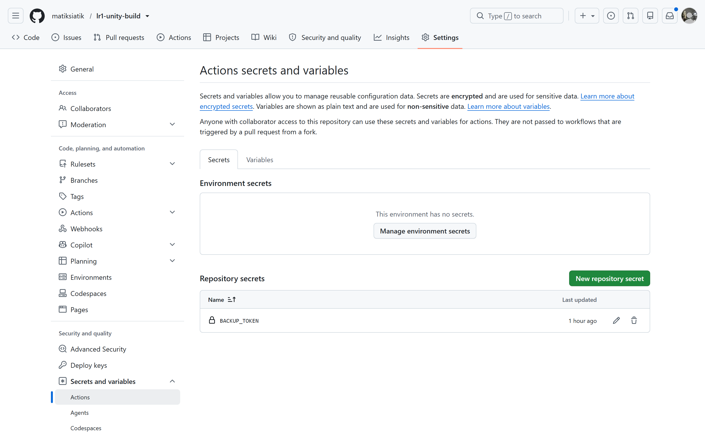
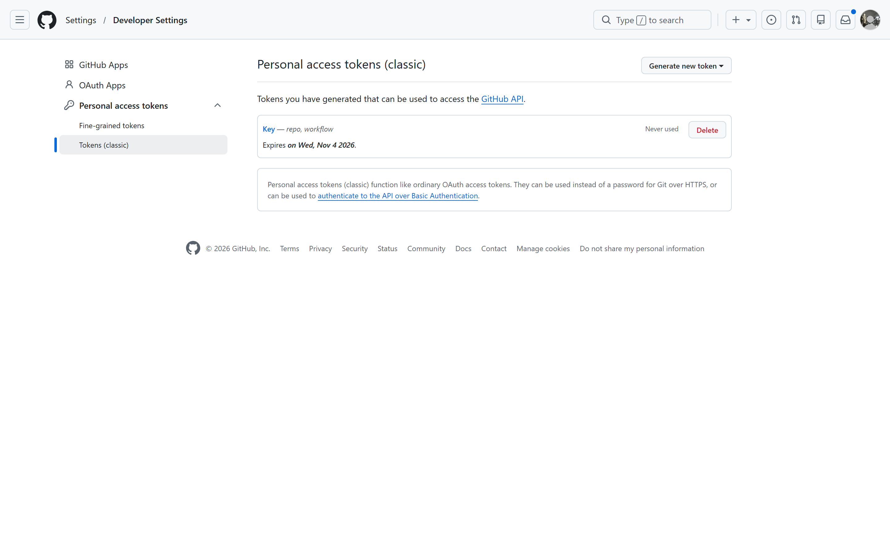
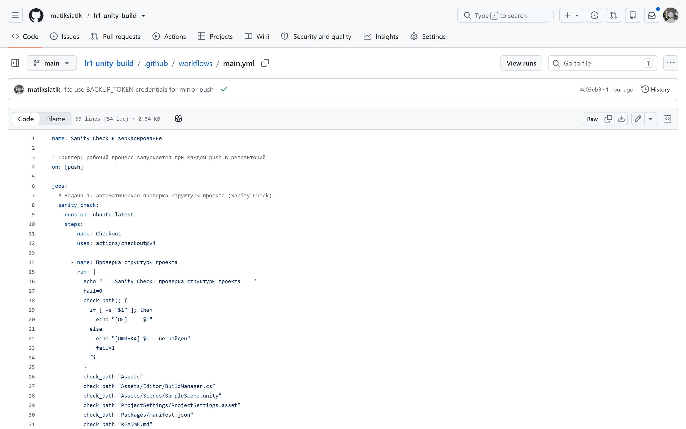
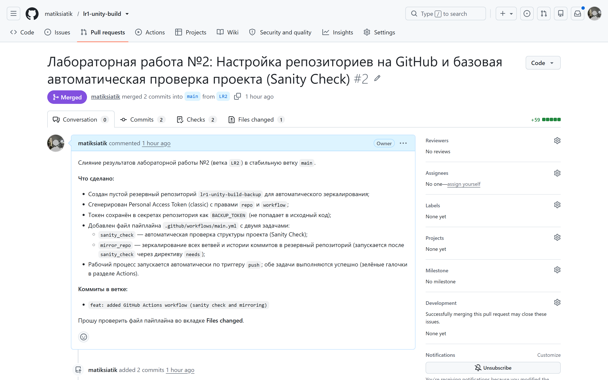
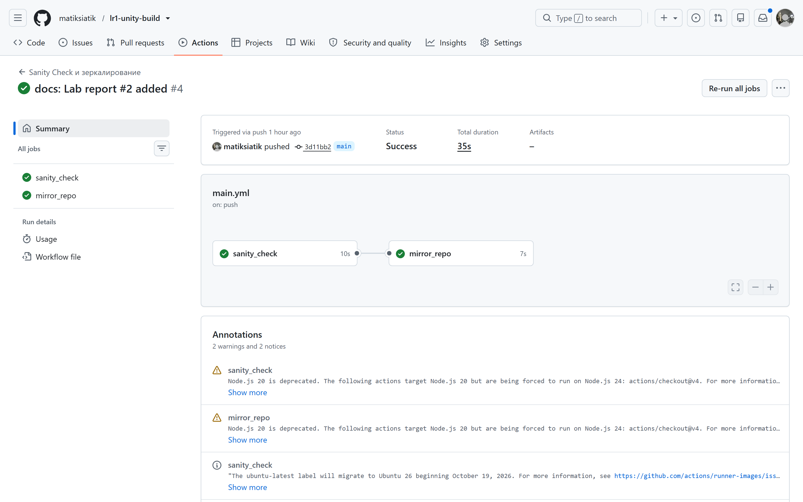
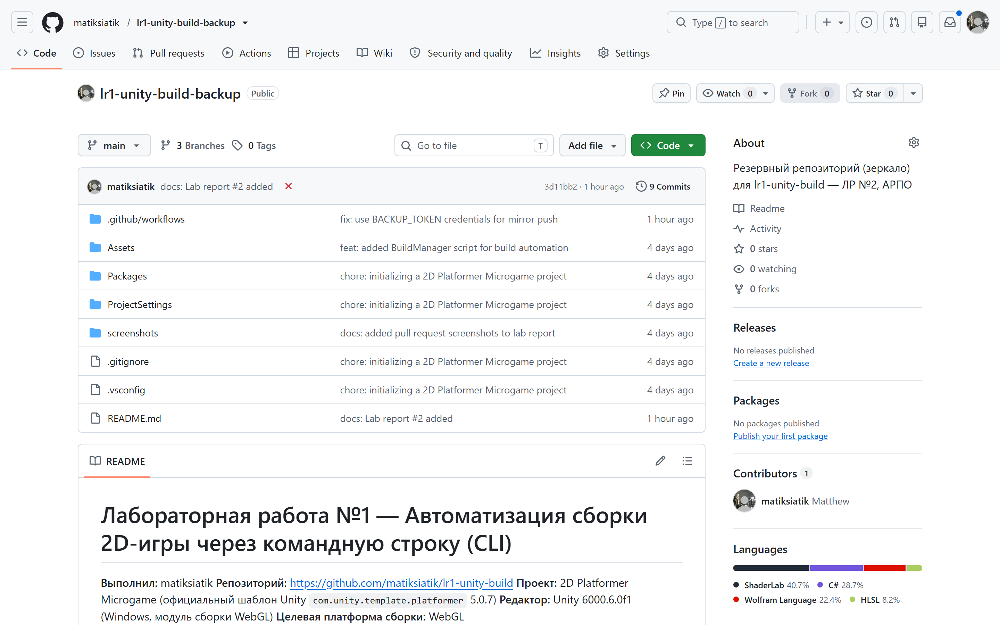
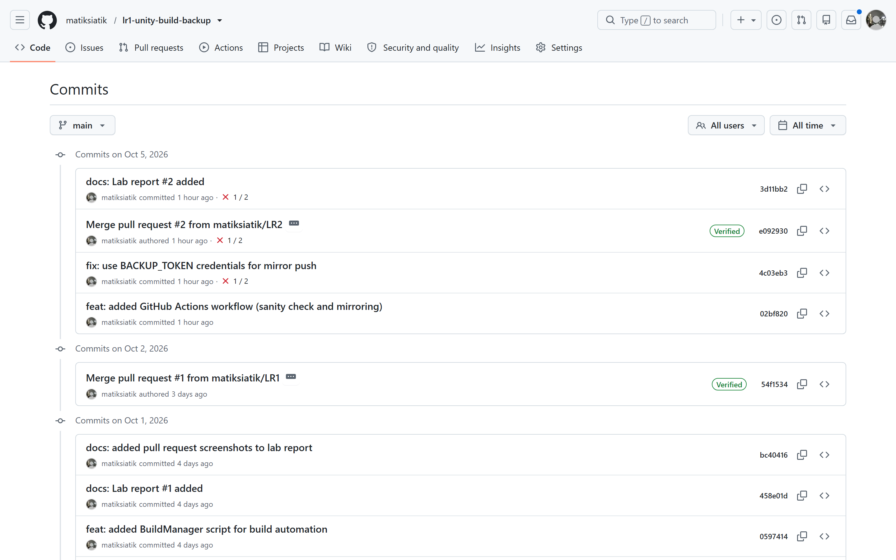

# Лабораторная работа №2 — Настройка репозиториев на GitHub и базовая автоматическая проверка проекта (Sanity Check)

**Выполнил:** matiksiatik
**Основной репозиторий:** <https://github.com/matiksiatik/lr1-unity-build>
**Резервный репозиторий:** <https://github.com/matiksiatik/lr1-unity-build-backup>

## Цель работы

Изучение принципов построения декларативных сценариев непрерывной интеграции (CI) на платформе GitHub Actions: автоматизация верификации структуры проекта (Sanity Check), безопасное управление секретами репозитория и настройка автоматического зеркалирования исходного кода в резервную инфраструктуру.

## Выполненные шаги

1. **Создан резервный репозиторий** `lr1-unity-build-backup` (пустой, без README и .gitignore) — приёмник для зеркалирования.
2. **Сгенерирован Personal Access Token (classic)** с правами `repo` и `workflow`.
3. **Токен сохранён в секретах репозитория** `lr1-unity-build`: Settings → Secrets and variables → Actions → `BACKUP_TOKEN` (значение не попадает в исходный код).
4. **Добавлен файл пайплайна** [`.github/workflows/main.yml`](.github/workflows/main.yml) с двумя задачами:
   - `sanity_check` — проверка структуры проекта (наличие ключевых папок и файлов: `Assets`, `Assets/Editor/BuildManager.cs`, `Assets/Scenes/SampleScene.unity`, `ProjectSettings/ProjectSettings.asset`, `Packages/manifest.json`, `README.md`, `.gitignore`, `.github/workflows/main.yml`);
   - `mirror_repo` — зеркалирование репозитория в резервный: полное копирование всех ветвей и истории коммитов (`fetch-depth: 0` + `git push --mirror`); запускается только после успешного `sanity_check` (директива `needs`).
5. **Изменения отправлены в ветку `LR2`**, создан Pull Request → смёржен в `main`.
6. **Проверка результатов:** в разделе Actions запуски завершились успешно (зелёные галочки `sanity_check` и `mirror_repo`); резервный репозиторий автоматически наполнен ветвями и полной историей коммитов.

## Скриншоты выполнения

*Рис. 1. Токен сохранён в секретах репозитория: Settings → Secrets and variables → Actions → `BACKUP_TOKEN`.*

*Рис. 2. Personal Access Token (classic) с правами `repo` и `workflow`.*

*Рис. 3. Файл пайплайна `.github/workflows/main.yml` (задачи `sanity_check` и `mirror_repo`).*

*Рис. 4. Изменения отправлены в ветку `LR2`, Pull Request смёржен в `main`.*

*Рис. 5. Раздел Actions: обе задачи завершились успешно (зелёные галочки).*

*Рис. 6. Резервный репозиторий `lr1-unity-build-backup` автоматически наполнен.*

*Рис. 7. В резервном репозитории скопированы все ветки и полная история коммитов.*
