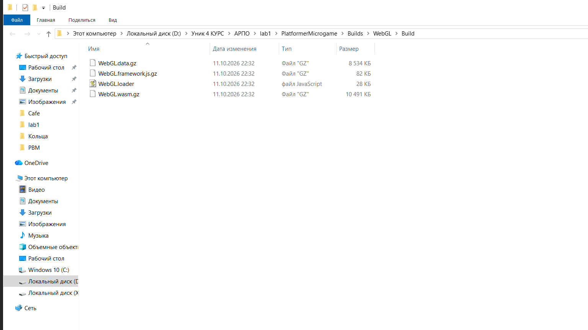
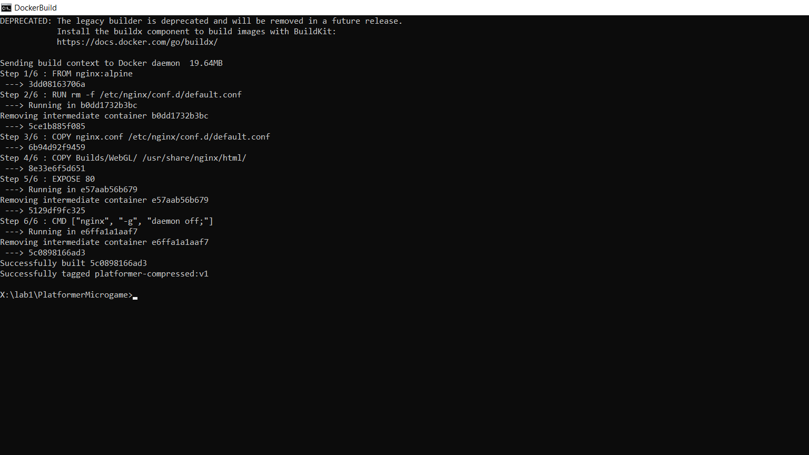
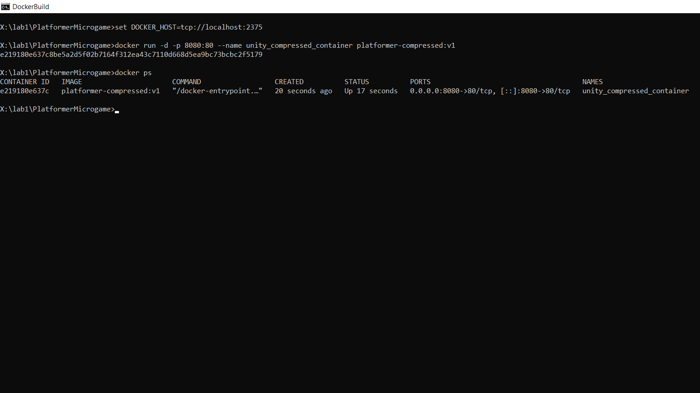
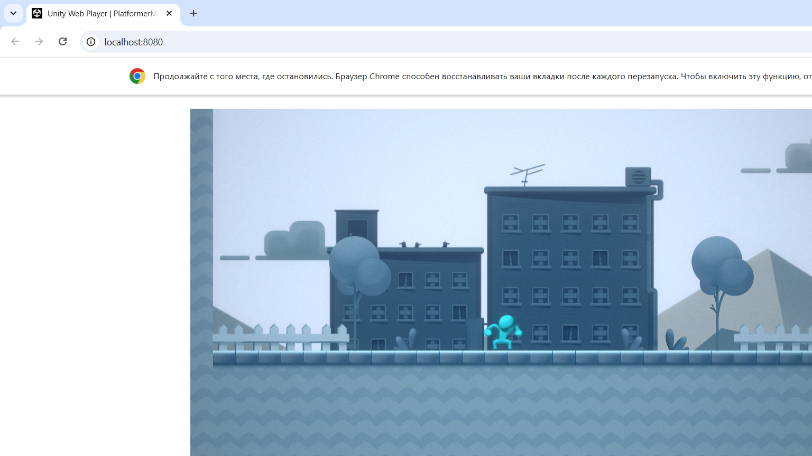
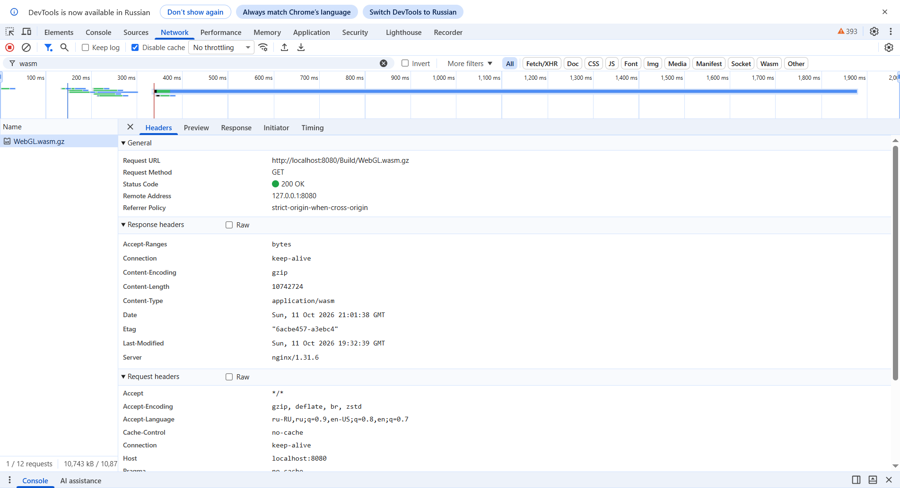
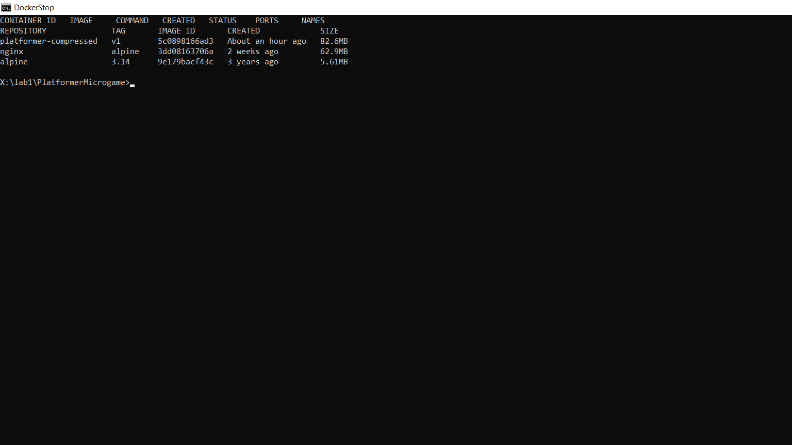

# Лабораторная работа №3 — Контейнеризация веб-сервера в Docker и раздача сжатых файлов со стороны Nginx

**Выполнил:** matiksiatik
**Репозиторий:** <https://github.com/matiksiatik/lr1-unity-build>
**Образ в GHCR:** <https://github.com/matiksiatik/lr1-unity-build/pkgs/container/lr1-unity-build>

## Цель работы

Настроить сжатие Gzip для WebGL-сборки Unity 6, разработать кастомную конфигурацию Nginx,
отдающую сжатые файлы с правильным заголовком `Content-Encoding: gzip`, упаковать веб-сервер
с игрой в Docker-образ и автоматизировать его публикацию в GitHub Container Registry (GHCR)
через GitHub Actions.

## Выполненные шаги

1. **Настройка сжатия в Unity 6.** В *File → Build Profiles → Player Settings → Player →
   WebGL → Publishing Settings* установлен **Compression Format = Gzip**, галочка
   **Decompression Fallback снята** (без JS-распаковщика на стороне игрока). Значения
   зафиксированы в `ProjectSettings/ProjectSettings.asset`: `webGLCompressionFormat: 1 (Gzip)`,
   `webGLDecompressionFallback: 0`.
2. **Пересборка проекта через CLI** (команда из ЛР №1):
   `Unity.exe -batchmode -nographics -executeMethod BuildManager.BuildWebGL -quit -logFile build_webgl_gzip.log`.
   В `Builds/WebGL/Build/` файлы получили расширения `.gz`:
   `WebGL.data.gz`, `WebGL.framework.js.gz`, `WebGL.wasm.gz` (+ несжатый `WebGL.loader.js`).
   Вес сборки: 58 МБ (без сжатия) → **19,6 МБ (Gzip)** — сжатие в ~3 раза.
3. **Конфигурация веб-сервера `nginx.conf`** (в корне проекта): сервер на порту 80, корень
   `/usr/share/nginx/html`; для `*.data.gz`, `*.wasm.gz`, `*.framework.js.gz` принудительно
   подставляются `Content-Encoding: gzip` и корректные `Content-Type`
   (`application/octet-stream`, `application/wasm`, `application/javascript`).
4. **Dockerfile** (в корне проекта): базовый образ `nginx:alpine`, удаление стандартного
   `default.conf`, копирование `nginx.conf` в `/etc/nginx/conf.d/default.conf` и WebGL-сборки
   в `/usr/share/nginx/html/`, `EXPOSE 80`, `CMD ["nginx", "-g", "daemon off;"]`.
5. **Локальное тестирование контейнера:**
   - `docker build -t platformer-compressed:v1 .` — образ собран (6 шагов, контекст ~19,6 МБ);
   - `docker run -d -p 8080:80 --name unity_compressed_container platformer-compressed:v1` —
     контейнер запущен, порт 8080 проброшен на 80;
   - игра загружена в браузере на `http://localhost:8080`;
   - в DevTools (F12 → Network) у `WebGL.wasm.gz` подтверждены заголовки
     **`Content-Encoding: gzip`** и `Content-Type: application/wasm`;
   - контейнер остановлен и удалён: `docker stop` + `docker rm`.
6. **Модернизация пайплайна** `.github/workflows/main.yml`: добавлена третья задача
   `docker_publish` (после `sanity_check`, директива `needs`): так как папка `Builds/`
   отсечена `.gitignore`, на раннере создаются временные файлы-заглушки `.gz`
   (`touch Builds/WebGL/Build/WebGL.wasm.gz` и т.д.), выполняется вход в GHCR
   (`docker/login-action@v3`, секрет `GITHUB_TOKEN`) и сборка/публикация образа
   (`docker/build-push-action@v6`) с тегом ревизии коммита
   `ghcr.io/matiksiatik/lr1-unity-build:${{ github.sha }}`.
7. **Проверка результатов:** во вкладке Actions все три задачи (`sanity_check`,
   `mirror_repo`, `docker_publish`) завершены успешно; во вкладке Packages профиля
   появился пакет-образ `lr1-unity-build`; файлы `Dockerfile`, `nginx.conf` и обновлённый
   `main.yml` присутствуют в репозитории.

## Скриншоты выполнения

*Рис. 1. Результат пересборки: сжатые файлы Unity 6 (Gzip) в `Builds/WebGL/Build/`.*

*Рис. 2. Сборка образа: все 6 шагов Dockerfile успешно выполнены.*

*Рис. 3. Запуск контейнера в фоне с пробросом порта 8080:80 (`docker ps` — Up).*

*Рис. 4. Игра загружается из контейнера в браузере (gzip-файлы распаковываются нативно).*

*Рис. 5. DevTools → Network → Headers файла `WebGL.wasm.gz`: `Content-Encoding: gzip`,
`Content-Type: application/wasm`, `Server: nginx`.*

*Рис. 6. После `docker stop` и `docker rm`: список контейнеров пуст, образ сохранён.*
