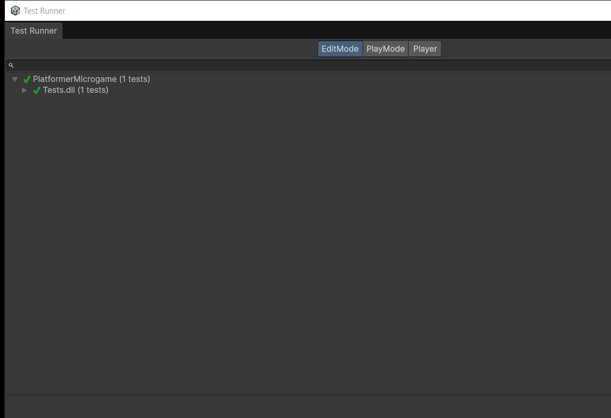
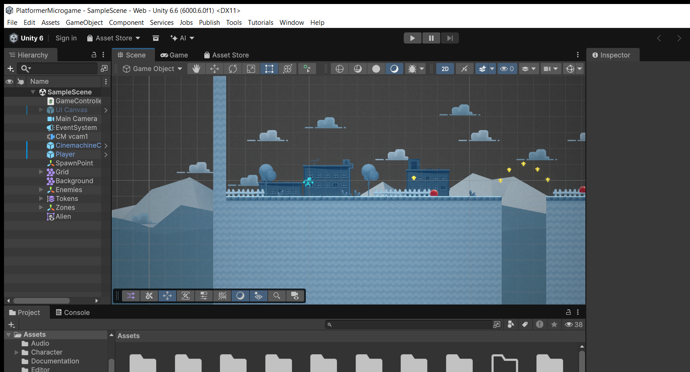
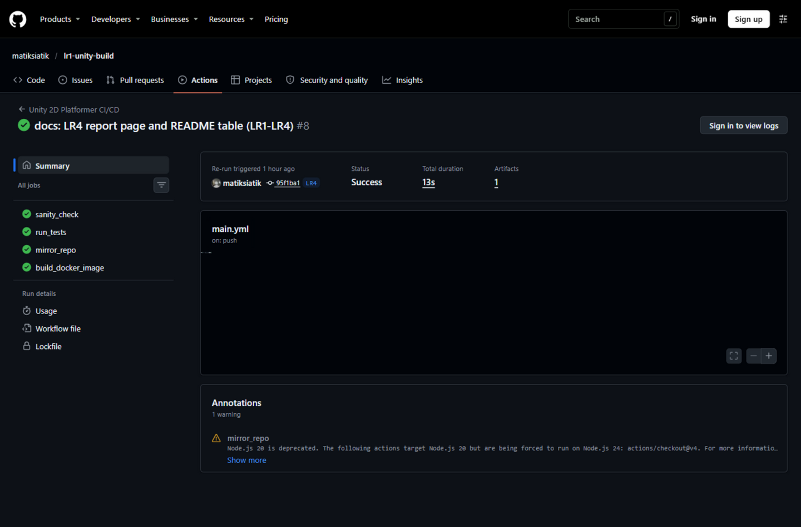
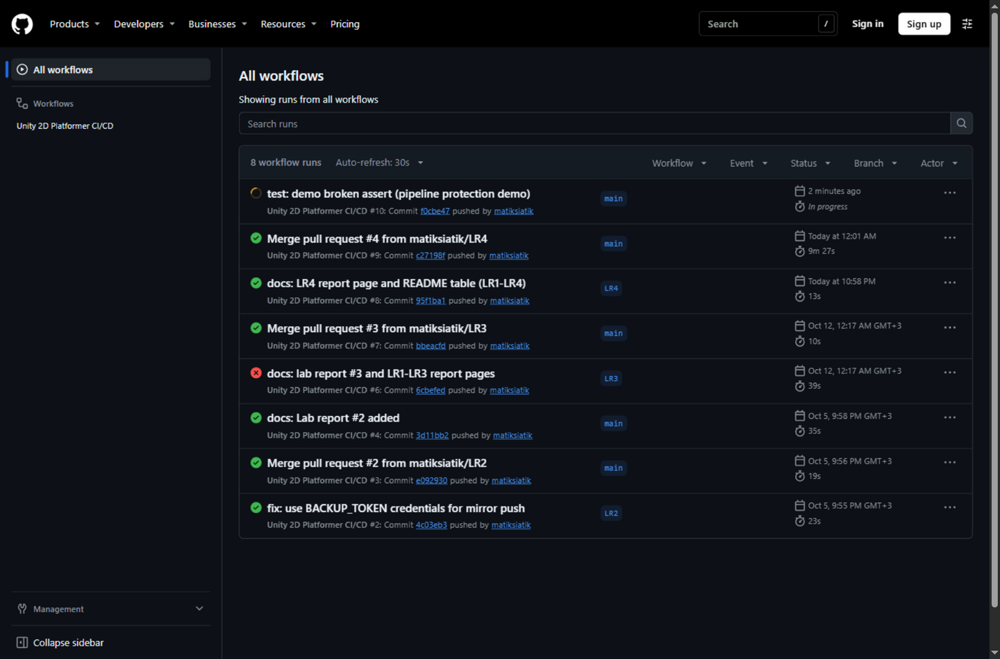
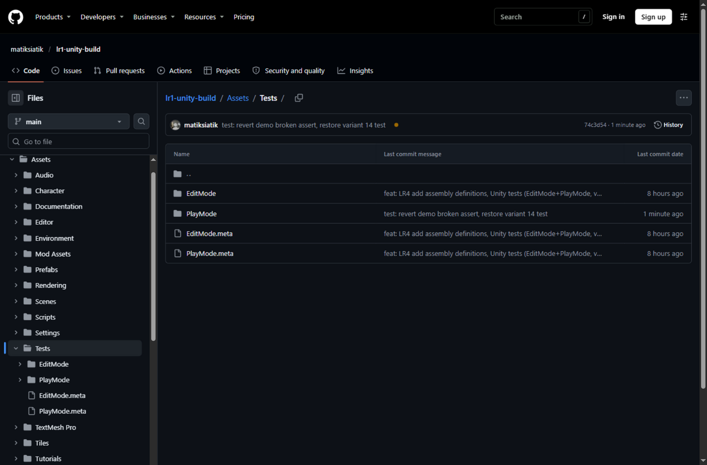
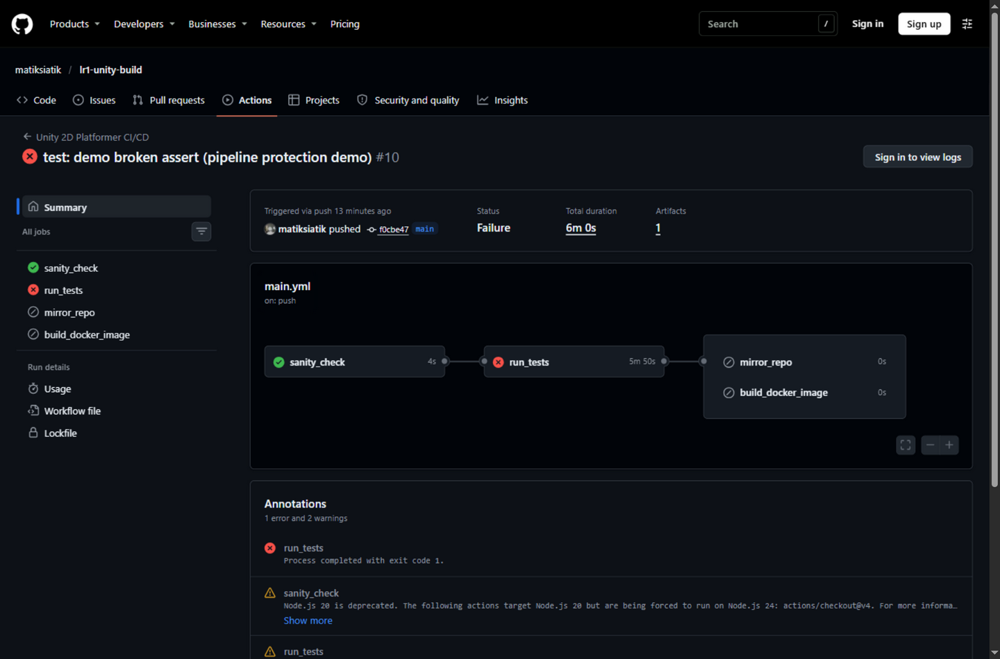
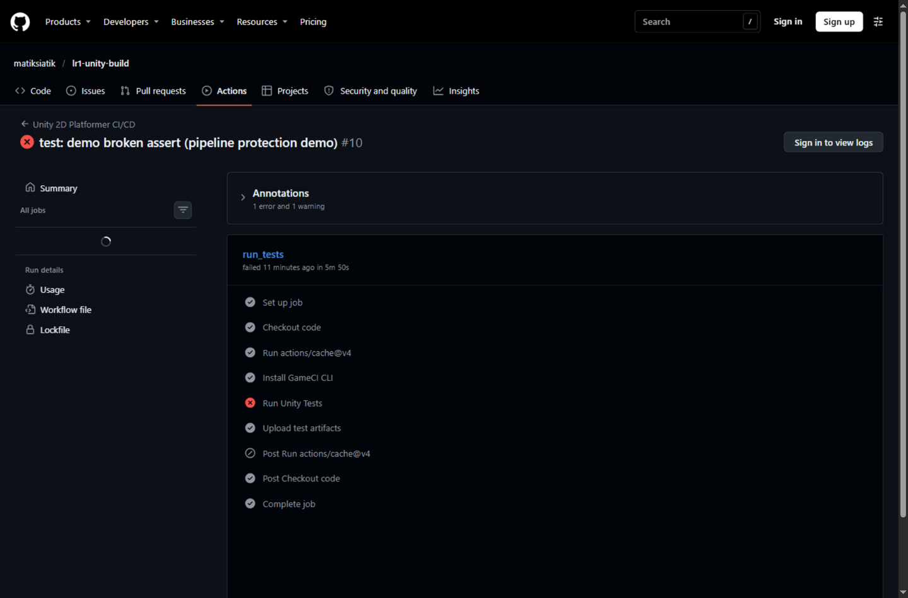
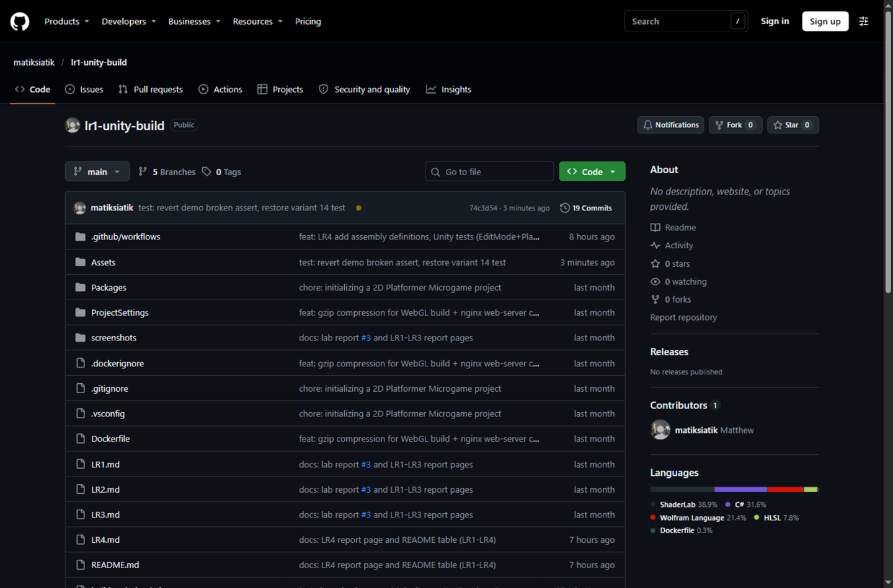

# Лабораторная работа №4 — Автоматизация тестирования (Unity Test Runner) в CI/CD

**Выполнил:** matiksiatik
**Репозиторий:** <https://github.com/matiksiatik/lr1-unity-build>
**Индивидуальный вариант №14:** EnemyDeath PlayMode — прыжок на врага сверху генерирует событие `EnemyDeath`

## Цель работы

Настроить автоматический запуск Unity-тестов (EditMode и PlayMode) в облачном пайплайне GitHub
Actions так, чтобы облачная компиляция игры и сборка Docker-образа выполнялись только при
успешном прохождении всех тестов.

## Выполненные шаги

1. **Разделение кодовой базы (Assembly Definitions).** В `Assets/Scripts/` создан
   `GameAssembly.asmdef` (ссылки на пакеты `Unity.InputSystem` и `Unity.Cinemachine`,
   которые использует код игры). В корне `Assets/` создана папка `Tests` с двумя вложенными
   папками: `Tests/EditMode` и `Tests/PlayMode`. Через окно **Window → General → Test Runner**
   логика сборок создана вручную (по шаблонам UTF):
   - `Tests/EditMode/Tests.asmdef` — параметр `"includePlatforms": ["Editor"]` (EditMode-сборка);
   - `Tests/PlayMode/PlayModeTests.asmdef` — без ограничения платформ (PlayMode-сборка);
   - обе сборки ссылаются на `GameAssembly` и на тестовые сборки `UnityEngine.TestRunner`,
     `UnityEditor.TestRunner` (плюс `overrideReferences` + `nunit.framework.dll` и
     `defineConstraints: UNITY_INCLUDE_TESTS`, как генерирует сам Unity Test Framework).
2. **Тест по варианту №14 (`EnemyDeathTests.cs`, PlayMode).** Воссоздаётся игровая ситуация
   «прыжок на врага сверху»: создаются временные объекты врага (BoxCollider2D + Rigidbody2D +
   EnemyController — как у стандартного `Enemy.prefab`, без `Health`) и игрока
   (BoxCollider2D + Rigidbody2D + Animator + PlayerController), игрок располагается над врагом
   так, что `player.Bounds.center.y >= enemy.Bounds.max.y` — то же условие
   `willHurtEnemy`, которое проверяет `PlayerEnemyCollision.Execute()`. Событие
   `PlayerEnemyCollision` шедулится так же, как это делает физика через
   `EnemyController.OnCollisionEnter2D`, затем выполняется `Simulation.Tick()` (в игре его
   делает `GameController.Update`). Через хук `Simulation.Event<T>.OnExecute` тест
   подсчитывает выполнение событий и проверяет: событие `EnemyDeath` сгенерировано ровно один
   раз, коллайдер и EnemyController врага отключены (эффекты `EnemyDeath.Execute`),
   игрок отскочил вверх (`player.velocity.y > 0`).
3. **Базовые тесты из методички:** `PlayerTests.cs` (EditMode — открывает сцену
   `Assets/Scenes/SampleScene.unity`, проверяет наличие объекта игрока `Player`, его тег и
   компоненты PlayerController/Health) и `PlayerHealthTests.cs` (PlayMode — проверяет логику
   `Health.Decrement()`/`IsAlive` при 3 хитпоинтах).
4. **Локальный запуск тестов.** В окне Test Runner тесты выполнены в обоих режимах — все
   зелёные; дополнительно прогнаны в batch-режиме Unity:
   `Unity.exe -batchmode -nographics -runTests -testPlatform EditMode|PlayMode -testResults ...`
   — оба результата: `Passed` (см. скриншоты).
5. **Автоматический запуск тестов в GitHub Actions.** В `.github/workflows/main.yml` добавлена
   задача `run_tests` (после `sanity_check`, директива `needs`): официальный CLI GameCI
   (v0.1.72) запускает тесты в контейнере `unityci/editor` сразу в двух режимах
   (`--testPlatforms='playmode;editmode;COMBINE_RESULTS'`), версия движка передаётся явно
   (`--engineVersion=6000.6.0f1`), coverage отключён
   (`--coverageEnabled=false` — инструментирование кода роняет Unity 6 в контейнере с SIGSEGV).
   Задачи `mirror_repo` и `build_docker_image` перевешены на `needs: run_tests` — при падении
   любого теста зеркалирование и сборка Docker-образа не запускаются.
6. **Лицензия Unity для облака.** В секреты репозитория добавлены `UNITY_LICENSE`,
   `UNITY_EMAIL`, `UNITY_PASSWORD` (Unity Personal). Результаты тестов и логи сохраняются
   артефактом `test-results` (`actions/upload-artifact@v4`, `if: always()`).
7. **Проверка защиты пайплайна:** временно внесена ошибка в тест (`Assert.AreEqual(1, 2)`) и
   выполнен push — задача `run_tests` стала красной, задачи зеркалирования и сборки Docker-образа
   не запустились (помечены skipped). После возврата исправленного кода пайплайн снова зелёный.
8. **Обновлены README.md** (таблица со ссылками на LR1–LR4) и создан этот файл LR4.md.

## Скриншоты выполнения

*Рис. 1. Локальный запуск: окно Test Runner, вкладка EditMode — тест `PlayerTests` зелёный.*

*Рис. 2. Проект PlatformerMicrogame в редакторе Unity 6 (6000.6.0f1) во время GUI-прогона тестов.*

*Рис. 3. GitHub Actions: все задачи (`sanity_check`, `run_tests`, `mirror_repo`, `build_docker_image`) зелёные.*

*Рис. 4. Вкладка Actions: список прогонов пайплайна Unity 2D Platformer CI/CD.*

*Рис. 5. Страница прогона: артефакт `test-results` с XML-результатами EditMode и PlayMode.*

*Рис. 6. Папка `Assets/Tests` с тестами и .asmdef-файлами в GitHub-репозитории.*

*Рис. 7. Демонстрация защиты: намеренно сломанный тест — задача `run_tests` красная.*

*Рис. 8. Детали задачи `run_tests`: упавший шаг Run Unity Tests (GameCI CLI, exit code 1).*

*Рис. 9. README.md обновлён таблицей со ссылками на LR1–LR4.*

## Результаты тестов

| Тест | Режим | Результат |
| --- | --- | --- |
| `PlayerTests.EditMode_PlayerTag_IsCorrect` | EditMode | ✅ Passed |
| `PlayerHealthTests.PlayMode_PlayerTakesDamage_HealthDecreases` | PlayMode | ✅ Passed |
| `EnemyDeathTests.PlayMode_JumpOnEnemyFromAbove_TriggersEnemyDeath` (**вариант 14**) | PlayMode | ✅ Passed |

**Контрольные вопросы**

1. **В чем принципиальное различие между EditMode и PlayMode тестами в Unity?**
   EditMode-тесты — легковесные: выполняются в редакторе без запуска симуляции игры и
   проверяют конфигурацию (сцены, объекты, теги, настройки компонентов). PlayMode-тесты —
   интеграционные: запускают игру в фоновом режиме, выполняются покадрово как корутины
   (`[UnityTest]`/`IEnumerator`), позволяют имитировать физику и ввод и проверять изменение
   состояния объектов во времени.
2. **Какую роль играет файл Assembly Definition (.asmdef) при создании тестовой структуры
   проекта?** Он изолирует код в отдельные сборки: тесты получают ссылку на игровую сборку
   (`GameAssembly`) и «видят» её код, а сами тестовые библиотеки (NUnit и т.д.) благодаря
   `defineConstraints: UNITY_INCLUDE_TESTS` не попадают в финальную сборку игры. Отдельные
   .asmdef для EditMode (`includePlatforms: ["Editor"]`) и PlayMode гарантируют, что каждая
   тестовая сборка запускается в правильном режиме.
3. **Почему в файле main.yml задача build_docker_image теперь зависит от needs: run_tests?**
   Тесты — главный фильтр качества CI: сборка и публикация имеют смысл только для кода,
   прошедшего тесты. Цепочка `needs` не запускает зависимые задачи при падении `run_tests`,
   поэтому сломанный коммит автоматически блокируется и не доходит до сборки Docker-образа
   и зеркалирования.
4. **Как настройка includePlatforms в тестовой сборке влияет на выбор режима запуска
   тестов?** Сборка с `"includePlatforms": ["Editor"]` компилируется только в редакторе и её
   тесты видны как EditMode-тесты; сборка без ограничения платформ компилируется и в рантайме,
   и её тесты запускаются как PlayMode. Если смешать тесты в одной сборке, Unity запустит их
   в неправильном режиме и тесты будут падать.
